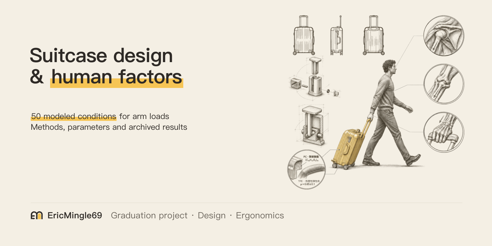
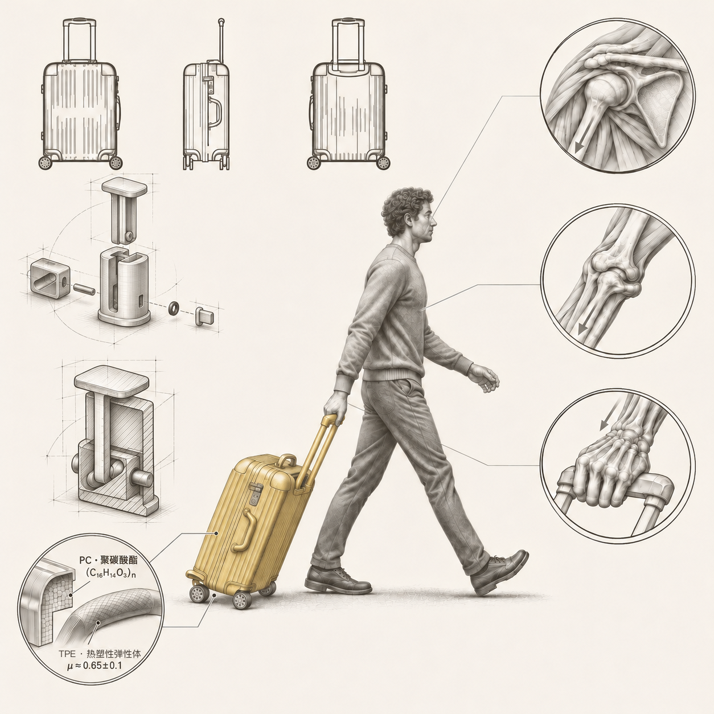

<picture>
  <source media="(prefers-color-scheme: dark)" srcset="readme-assets/cover-en-dark.png">
  
</picture>

<p align="center">
  <a href="01仿真数据/1仿真总结/仿真方法/">Methods</a> · <a href="01仿真数据/数据库/">Parameters</a> · <a href="01仿真数据/结果/">Archived results</a> · <a href="PERSONAL-NOTICE.md">Permissions</a>
</p>
<p align="center">
  <a href="readme-assets/PERSONAL-DOCUMENTATION-LICENSE.md"></a>
  
  
  
</p>

<p align="center"><a href="README.md">简体中文</a> · <b>English</b></p>

# Human factors in suitcase structural design and simulation

This graduation project examines upper-limb loads during suitcase handling alongside structural design. This repository archives Python calculations, parameter tables, method notes and historical results. An L50 table defines 50 modeled conditions for estimates of hand forces, shoulder/elbow/wrist moments, relative muscle loads and finger contact forces.

## Overview

The broader graduation project involves questionnaires, clustering, AnyBody human simulation, orthogonal experiments and analytic hierarchy analysis. The public repository focuses on a custom Python human-factors calculation workflow. Raw questionnaires, complete clustering and hierarchy-analysis implementations, and runnable AnyBody projects are not included in the current files.

Start with the [structure guide](01仿真数据/文件结构.md) and [method notes](01仿真数据/1仿真总结/仿真方法/), then inspect the scripts and parameters. The guide uses the historical root name “仿真3.0”; the actual directory is `01仿真数据/`.

## Design highlights

- **Structure and handling considered together**: suitcase body, handle locking mechanism and grip design are considered alongside shoulder, elbow and wrist loads during pulling.
- **Traceable conditions**: sex, body-size percentile, surface, posture and luggage mass define the experiment inputs; the design script and parameter tables are stored separately.
- **Separate calculation and result archives**: experiment plans, joint-load calculations and finger-force outputs have separate directories for checking inputs against historical outputs.

## Results

The illustration presents the design focus on suitcase structure, the handle mechanism and upper-limb joints. Material annotations describe design concepts; performance and applicability require material data and testing. The approved material annotations remain in Chinese.

<picture>
  <source media="(prefers-color-scheme: dark)" srcset="readme-assets/design-dark.png">
  
</picture>

| Archived content | Entry |
| --- | --- |
| Experiment conditions | [Design outputs](01仿真数据/结果/正交设计/) |
| Hand forces, joint moments and loads | [Calculation outputs](01仿真数据/结果/计算/) |
| Finger forces | [Grip outputs](01仿真数据/结果/握把/) |
| Historical analysis | [Simulation data analysis](01仿真数据/1仿真总结/仿真数据/stimulate_data_analysis.md) |

Values and risk interpretations in the historical analysis have not been independently reviewed. This page does not present them as validated design performance.

## Method

1. [Data loading](01仿真数据/数据加载.py) reads 7 categories of CSV parameters: anthropometry, segment inertia, joints, muscle mechanics, scenarios, functional ergonomics and dynamic simulation.
2. [Experiment design](01仿真数据/正交设计.py) uses the first 5 columns of the York L50 table identified in the script to generate 50 conditions.<sup>[[1]](#references)</sup>
3. [Combined calculations](01仿真数据/综合计算.py) combine load and posture inputs to estimate hand resultants, shoulder/elbow/wrist moments, MVC percentage (load relative to maximum voluntary contraction), a fatigue penalty and finger contact forces.

| Factor | Values in the script |
| --- | --- |
| Sex parameter | Male, female |
| Body-size percentile | P5, P10, P50, P90, P95 |
| Surface | Airport level surface, slope, rough ground |
| Handling posture | Horizontal pushing, incline pulling, lateral lifting, turning, obstacle crossing |
| Luggage mass | 8, 14, 20 kg |

Surface and mass map 5 logical levels onto 3 physical levels in a 2:2:1 ratio. Analysis must account for this unequal mapping rather than treating every physical factor level as equally frequent.

<details>
<summary>Reading and execution order</summary>

The code uses Python, pandas and NumPy. Versions are not pinned and no unified setup procedure is provided. Reproduction requires checking parameter provenance, environment versions and model assumptions.

```sh
cd 01仿真数据
python 正交设计.py
python 综合计算.py
```

`数据加载.py` is the loading module used by the calculation workflow. The combined calculation script reads a design from the experiment-output directory and writes calculation and grip outputs. Running it creates additional result files. This is the script entry order, not a claim that the full workflow has been reproduced in the current environment.

</details>

## Limitations

- Parameter provenance, applicable populations and redistribution rights still require individual verification. File availability does not establish validity.
- The model uses simplified loads, joint representations and empirical parameters; it does not replace full musculoskeletal dynamics or human testing.
- The archive has no pinned dependencies, automated validation workflow or independent review record. Historical outputs must not be used directly for human safety decisions.
- There is no root source-code license. The documentation MIT license does not cover existing code, parameters, research material or third-party content.

## Acknowledgements

The project uses Python, pandas and NumPy for data handling and calculations. The orthogonal-array source is listed below. Existing materials and third-party content retain their original attribution.

The cover illustration was generated by an image-generation model.

## References

1. University of York, Department of Mathematics. *L50 orthogonal array*. [Source table](https://www.york.ac.uk/depts/maths/tables/l50.htm). The table source explicitly identified in `正交设计.py`.

## Related research

- Damsgaard, M., Rasmussen, J., Christensen, S. T., Surma, E., & de Zee, M. (2006). *Analysis of musculoskeletal systems in the AnyBody Modeling System*. Simulation Modelling Practice and Theory, 14(8), 1100–1111. [DOI](https://doi.org/10.1016/j.simpat.2006.09.001). Relates to musculoskeletal modeling and inverse dynamics; it provides research context, not evidence that the Python code implements that system.

## Repository structure

```text
01仿真数据/
├── 数据加载.py
├── 正交设计.py
├── 综合计算.py
├── 数据库/          # 7 parameter categories
├── 结果/            # Experiment, calculation and grip outputs
└── 1仿真总结/       # Method notes and historical analysis
readme-assets/       # Light/dark covers, design illustrations and logo
```

---

Maintained by <picture><source media="(prefers-color-scheme: dark)" srcset="readme-assets/em-logo-dark.svg"></picture> <b>EricMingle69</b> · <a href="https://github.com/Ming-Sir-69">Ming-Sir-69</a><br>
Original documentation and cover layout: [MIT](readme-assets/PERSONAL-DOCUMENTATION-LICENSE.md) · Existing code and material rights: [permissions](PERSONAL-NOTICE.md).
