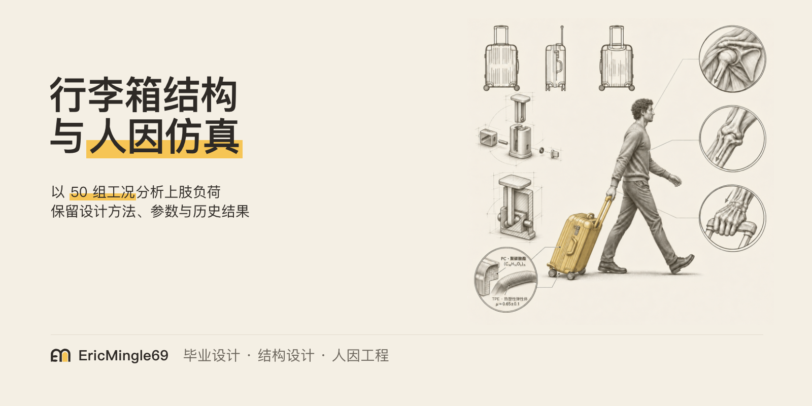
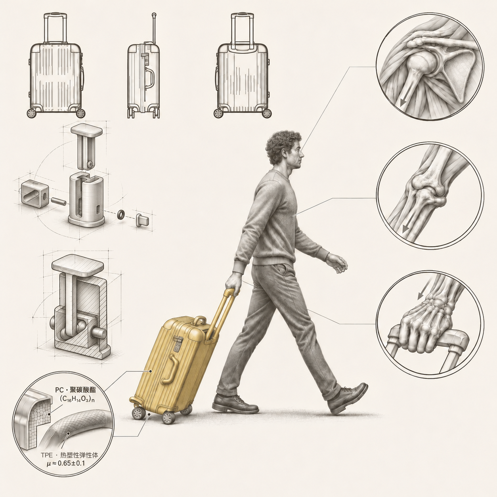

<picture>
  <source media="(prefers-color-scheme: dark)" srcset="readme-assets/cover-zh-dark.png">
  
</picture>

<p align="center">
  <a href="01仿真数据/1仿真总结/仿真方法/">仿真方法</a> · <a href="01仿真数据/数据库/">参数表</a> · <a href="01仿真数据/结果/">历史结果</a> · <a href="PERSONAL-NOTICE.md">许可说明</a>
</p>
<p align="center">
  <a href="readme-assets/PERSONAL-DOCUMENTATION-LICENSE.md"></a>
  
  
  
</p>

<p align="center"><b>简体中文</b> · <a href="README.en.md">English</a></p>

# 基于人因工程的行李箱结构设计与仿真

本项目围绕行李箱拉杆弹簧卡槽结构、箱体材料与操作中的上肢负荷开展毕业设计，结合结构设计、材料比较与人因分析。本仓库归档 Python 计算脚本、参数表、方法说明和历史结果，以 L50 表生成 50 组工况，估算手部作用力、肩肘腕关节力矩、相对肌肉负荷及手指接触力。

## 概述

毕业设计以拉杆弹簧卡槽结构为核心，并从成本、性能和加工工艺比较箱体材料；结构图纸与材料分析未归档于本仓库。

毕业设计整体涉及问卷、聚类、AnyBody 人体仿真、正交实验与层次分析。本仓库公开部分集中在自编 Python 人因计算流程；问卷原始记录、聚类与层次分析的完整实现、可运行的 AnyBody 工程不在当前文件中。

阅读可从[文件结构说明](01仿真数据/文件结构.md)与[仿真方法](01仿真数据/1仿真总结/仿真方法/)开始，再核对脚本和参数。结构说明沿用旧顶层名“仿真3.0”，实际目录为 `01仿真数据/`。

## 设计要点

- **结构与操作共同考虑**：围绕箱体、拉杆弹簧卡槽结构和握持部位展开设计，并关注拖行过程的肩、肘、腕负荷。
- **材料比较**：从成本、性能和加工工艺比较箱体材料；当前仓库不含完整材料分析。
- **工况可追溯**：性别、人体百分位、路面、姿态与行李质量共同构成实验输入；设计脚本与参数表分别保存。
- **计算与结果分开归档**：实验方案、关节负荷计算和手指受力输出分目录保存，便于核对输入与历史产出。

## 成果展示

以下生成插画展示行李箱结构、拉杆机构与上肢关节的设计关注点。材料标注属于设计表达，具体性能与适用范围需以材料数据和试验为依据。

<picture>
  <source media="(prefers-color-scheme: dark)" srcset="readme-assets/design-dark.png">
  
</picture>

| 归档内容 | 阅读入口 |
| --- | --- |
| 工况设计 | [正交设计结果](01仿真数据/结果/正交设计/) |
| 手部作用力、关节力矩与负荷 | [计算结果](01仿真数据/结果/计算/) |
| 手指受力 | [握把结果](01仿真数据/结果/握把/) |
| 历史分析 | [仿真数据分析](01仿真数据/1仿真总结/仿真数据/stimulate_data_analysis.md) |

历史分析中的数值和风险判断尚未独立复核，本页不将其作为已验证的设计性能结论。

## 方法

1. [数据加载](01仿真数据/数据加载.py)读取 7 类 CSV 参数：人体测量、肢段惯性、关节、肌肉力学、场景、功能人因和动态仿真参数。
2. [正交设计](01仿真数据/正交设计.py)采用脚本所注明的 York L50 表前 5 列，生成 50 组方案。<sup>[[1]](#参考文献)</sup>
3. [综合计算](01仿真数据/综合计算.py)结合载荷与姿态参数，计算手部合力、肩肘腕力矩、MVC 百分比（相对最大随意收缩水平的负荷指标）、疲劳惩罚值及手指估算接触力。

| 因子 | 脚本中的取值 |
| --- | --- |
| 性别参数 | 男、女 |
| 人体百分位 | P5、P10、P50、P90、P95 |
| 路面 | 机场平面、斜坡、粗糙地面 |
| 操作姿态 | 水平推进、斜坡拉行、侧向拉提、转向操作、越障动作 |
| 行李质量 | 8、14、20 kg |

路面与质量将 5 个逻辑水平按 2:2:1 合并为 3 个实际水平；分析时需考虑这种不均衡映射，不能直接把映射后的全部因子视为等频水平。

<details>
<summary>阅读与运行顺序</summary>

代码使用 Python、pandas 和 NumPy，仓库未锁定版本，也未提供统一安装流程。复现前需核实参数来源、环境版本及模型假设。

```sh
cd 01仿真数据
python 正交设计.py
python 综合计算.py
```

`数据加载.py` 是计算流程使用的加载模块。综合计算从正交设计结果目录读取方案，并写入计算、握把结果目录；运行会新增结果文件。以上为脚本入口顺序，未代表全流程已在当前环境复现。

</details>

## 局限

- 参数表的来源、适用人群及再分发权限尚需逐项核实；文件存在不等于数据已经验证。
- 模型采用简化载荷、关节与经验参数，不能代替完整肌骨动力学或真人测试。
- 当前归档没有依赖锁定、自动验证流程或独立复核记录；历史结果不能直接用于人体安全决策。
- 根目录没有源码许可证。文档 MIT 许可不覆盖原有代码、参数、研究资料和第三方内容。

## 致谢

本项目使用 Python、pandas 和 NumPy 整理与计算数据，正交表来源见下方参考文献。既有资料与第三方内容保留其原有归属。

封面插画与设计插画由图像生成模型生成，经本项目处理。

## 参考文献

1. University of York, Department of Mathematics. *L50 orthogonal array*. [原表](https://www.york.ac.uk/depts/maths/tables/l50.htm)。`正交设计.py` 明确标注的表格来源。

## 相关研究

- Damsgaard, M., Rasmussen, J., Christensen, S. T., Surma, E., & de Zee, M. (2006). *Analysis of musculoskeletal systems in the AnyBody Modeling System*. Simulation Modelling Practice and Theory, 14(8), 1100–1111. [DOI](https://doi.org/10.1016/j.simpat.2006.09.001)。对应人体肌骨系统与逆动力学分析；用于说明研究背景，不表示本仓库的 Python 计算实现了该系统。

## 仓库结构

```text
01仿真数据/
├── 数据加载.py
├── 正交设计.py
├── 综合计算.py
├── 数据库/          # 7 类参数表
├── 结果/            # 正交设计、计算与握把结果
└── 1仿真总结/       # 方法说明与历史分析
readme-assets/       # 亮暗封面、设计插画与 logo
```

---

文档维护：<picture><source media="(prefers-color-scheme: dark)" srcset="readme-assets/em-logo-dark.svg"></picture> <b>EricMingle69</b> · <a href="https://github.com/Ming-Sir-69">Ming-Sir-69</a><br>
文档原创说明与封面排版：[MIT](readme-assets/PERSONAL-DOCUMENTATION-LICENSE.md) · 原有代码与资料权限见[许可说明](PERSONAL-NOTICE.md)。
